# JANO Inventario: arquitectura técnica

Este documento explica cómo está hecha la plataforma. Es la base del **manual técnico**.

- La instalación está en [INSTALAR_EN_SERVIDOR.md](INSTALAR_EN_SERVIDOR.md).
- La operación diaria (respaldos, tareas programadas) está en [OPERACION.md](OPERACION.md).

## 1. Qué es

JANO Inventario es la plataforma web del área de TIC de Seguridad JANO para:

- llevar el **inventario de activos de TI**: radios, computadores, tabletas, impresoras, escáneres, GPS, alarmas y UPS;
- registrar **entregas** (actas firmadas) y **devoluciones**;
- controlar el **mantenimiento preventivo** semestral y las intervenciones;
- verificar la **política de seguridad informática** y las **licencias de antivirus**;
- atender las **solicitudes de soporte** (mesa de ayuda) y el portal **Mi soporte** de los funcionarios;
- emitir el **paz y salvo** de TIC cuando un funcionario se retira;
- generar **informes** en PDF y Excel, y dejar **auditoría** de todo lo que se hace.

## 2. Tecnología

| Pieza | Uso |
|---|---|
| Python 3.12 + Django 5.2 | Aplicación web (vistas, plantillas, base de datos, usuarios) |
| SQLite | Base de datos (`db.sqlite3`, ruta configurable con `DJANGO_DB_PATH`) |
| Waitress | Servidor de la aplicación en Windows (puerto 8080) |
| Passenger (Plesk) | Servidor de la aplicación en el hosting Ubuntu |
| WhiteNoise | Sirve los archivos estáticos (CSS, JS, imágenes) |
| Django REST Framework | API de solo lectura para la integración con Gestión TIC |
| ReportLab / openpyxl | Informes en PDF y Excel |
| Chart.js y Leaflet (CDN) | Gráficos y mapa del tablero de inicio |

Las dependencias exactas están en `requirements.txt`.

## 3. Estructura del código

```
config/                 Configuración de Django (settings.py, urls.py, wsgi.py)
usuarios/               Inicio (tablero), ingreso, recuperación de contraseña y
                        gestión de cuentas y roles
inventario/             Núcleo de la plataforma
  models.py             Todas las tablas (ver sección 4)
  forms.py              Formularios de registro y edición
  views*.py             Pantallas, agrupadas por tema:
    views_equipos.py      lista de equipos, fichas, buscador global, política
    views.py              radios: registro, entregas (actas) y devoluciones
    views_catalogos.py    clientes y puestos
    views_personas.py     funcionarios, retiros y paz y salvo
    views_tickets.py      mesa de ayuda interna (solicitudes)
    views_portal.py       portal "Mi soporte" de los funcionarios
    views_publicas.py     formulario público de soporte
    views_auditoria.py    consulta de la auditoría
    views_calidad.py      calidad de datos: pendientes y su corrección
  panel.py              Datos del tablero de inicio
  estado_mantenimiento.py  Cálculo del semáforo del preventivo (6 meses)
  actividades_mantenimiento.py  Actividades a revisar por tipo de equipo
  politica.py           Los 15 puntos de la política de seguridad
  tickets.py, agenda.py Flujo de los tickets y agenda de visitas
  personas.py           Reglas del retiro y del paz y salvo
  permisos.py           Roles y qué puede hacer cada uno
  auditoria.py          Registro automático de cambios (señales + middleware)
  calidad.py            Reglas de «Calidad de datos» (qué no cuadra y cómo se corrige)
  publico.py            Restricciones de acceso desde internet y del portal
  notificaciones.py     Correos (alertas, tickets)
  google_sheet.py       Lectura del Google Sheet para las importaciones
  informes/             Catálogo de informes (cada archivo = una categoría)
  management/commands/  Comandos de consola (importaciones, alertas, respaldos)
api_integracion/        API y eventos para Gestión TIC
templates/              Plantillas HTML (base.html = estructura con menú)
static/css/jano.css     Sistema de diseño (las hojas 01-23 son anteriores y se
                        irán retirando)
static/js/jano.js       Menú, buscador global, filtros y tema claro/oscuro
docs/                   Documentación
```

## 4. Modelo de datos

Cada tabla está documentada en `inventario/models.py`, con lo que guarda y sus reglas. El diagrama muestra las relaciones principales:

```mermaid
erDiagram
    Equipo ||--o| Radio : "detalle (RADIO)"
    Equipo ||--o| DetalleComputador : "detalle (COMPUTADOR, TABLETA)"
    Equipo ||--o| DetalleImpresora : "detalle (IMPRESORA, ESCANER)"
    Equipo ||--o| DetalleGPS : "detalle (GPS)"
    Equipo ||--o| DetalleAlarma : "detalle (ALARMA)"
    Equipo ||--o{ MantenimientoEquipo : intervenciones
    Equipo ||--o{ MantenimientoProgramado : visitas
    Equipo ||--o{ AlertaMantenimiento : avisos
    Equipo ||--o{ AsignacionEquipo : "entregas a funcionarios"
    Equipo ||--o{ VerificacionPolitica : verificaciones
    Equipo ||--o{ RenovacionAntivirus : renovaciones
    Equipo ||--o{ CambioGPS : cambios
    Equipo ||--o{ Ticket : solicitudes
    Radio ||--o{ AsignacionRadio : "entregas a puestos"
    Cliente ||--o{ Puesto : puestos
    Puesto ||--o{ AsignacionRadio : "radios del puesto"
    Funcionario ||--o{ AsignacionEquipo : recibe
    Funcionario ||--o{ RetiroFuncionario : retiros
    RetiroFuncionario ||--o{ ItemRetiro : "equipos a validar"
    Ticket ||--o{ EventoTicket : bitacora
    Ticket ||--o{ FotoTicket : fotos
    Ticket ||--o{ MantenimientoEquipo : "origina"
```



**Ideas clave**

- **`Equipo` es el registro común** de todo activo. Los datos propios de cada tipo están en una tabla de detalle uno a uno.
- **El radio se guarda en `Radio`**, que crea o actualiza su `Equipo` automáticamente (`Radio.sincronizar_equipo`). Por eso los radios aparecen en la lista general, en los mantenimientos y en los informes.
- **Entregas:**
  - Los radios se entregan a un **puesto de un cliente** y los recibe el **supervisor** (`AsignacionRadio`).
  - Los demás equipos se entregan a un **funcionario** (`AsignacionEquipo`).
  - Solo puede haber una entrega vigente por equipo; la base de datos lo garantiza con una restricción.
- **Bajas:** nada se borra. Un equipo dado de baja queda con `activo=False`, fecha y motivo, y se consulta en el *Baúl de bajas*.
- **Mantenimiento preventivo:** vence 6 meses después de la última intervención. El semáforo (vencido, vence en 30 días, vigente, sin mantenimiento) se calcula en `estado_mantenimiento.py`; no se guarda.

## 5. Usuarios, roles y permisos

Los roles son **grupos de Django**. Están definidos en `inventario/permisos.py` (diccionario `ACCIONES`), y el superusuario puede hacer todo.

| Rol | Puede |
|---|---|
| Encargado de inventario | Registrar y editar equipos y radios, hacer entregas, programar, iniciar retiros y validar equipos del paz y salvo, ver auditoría, crear y asignar solicitudes |
| Técnico de mantenimiento | Registrar mantenimientos, programar, ver claves de licencia, crear y atender solicitudes |
| Consulta | Ver el inventario sin modificarlo |
| Talento humano | Solo el módulo de Usuarios: personas, retiros y paz y salvo |
| Solicitante | Solo el portal **Mi soporte**: pedir soporte y agendar el preventivo de sus equipos |

**Dónde se aplica cada control**

- **En las vistas:** el decorador `@requiere_permiso("accion")` bloquea la acción y redirige al inicio con un mensaje.
- **En las plantillas:** `{{ permisos.accion }}` muestra u oculta botones y menús.
- **En el middleware:**
  - `SoloSoportePublicoMiddleware`: desde los dominios públicos (`DJANGO_HOSTS_PUBLICOS`) solo se ve la mesa de ayuda.
  - `SoloPortalSolicitanteMiddleware`: las cuentas de funcionarios solo ven `/mi-soporte/`.

## 6. Flujos principales

### 6.1 Entrega y devolución de un radio
1. **Equipos › Radio › Entregar.** Se elige el cliente y el puesto del catálogo y se registran el supervisor, el estado de cada pieza, la aceptación de la cláusula y la firma dibujada.
2. Se crea una `AsignacionRadio` en estado `ASIGNADO`. El radio copia el cliente, el puesto y el supervisor, y se genera el **acta** imprimible.
3. Al devolverlo, la entrega pasa a `DEVUELTO` con la fecha, quién lo recibió y sus observaciones, y el radio vuelve a bodega.

### 6.1.1 Entrega firmada de un equipo nuevo a un funcionario
1. **Registrar › tipo de equipo.** Al terminar los datos se elige **Guardar (queda en bodega)** o **Guardar y entregar con firma**.
2. Con la segunda opción se abre la página de firma (`equipo_entregar_firma`): funcionario que recibe, área, **estado en que se entrega** (por defecto *Nuevo* si el equipo nunca se ha entregado; *Usado en buen estado*; *Usado con detalles*, que exige describirlos en observaciones), accesorios, aceptación de la cláusula y firma con el dedo o el mouse.
3. Se crea la `AsignacionEquipo` con el estado (`estado_entrega`), el funcionario queda como responsable del equipo y se abre el **acta** lista para imprimir o guardar en PDF.
4. Las entregas posteriores (equipo que vuelve de bodega) se hacen desde la ficha › **Entregas y actas › Registrar entrega**, con los mismos datos.

### 6.1.2 Calidad de datos
Menú **Control › Calidad de datos** (encargado de inventario). Cada pestaña lista un tipo de pendiente con su acción:

| Pestaña | Qué detecta | Acción |
|---|---|---|
| Equipos sin entrega | Equipo con responsable escrito y sin entrega vigente. Si el responsable dice «baja» o «robado», se marca **¿Dar de baja?** | Entrega firmada (`?regularizar=1`: propone el funcionario por cédula y no sugiere *Nuevo*) o revisar la ficha |
| Entregas sin firma | Entrega vigente sin firma dibujada (solo enlace de Google o nada) | **Firmar en JANO** (`entrega_firmar`): estado, cláusula y firma; el enlace se conserva |
| Radios sin puesto | Entrega de radio sin `puesto` del catálogo, agrupada por cliente y puesto escritos | **Vincular puesto**: cliente sugerido por parecido y puestos ordenados; copia los nombres oficiales a la entrega y al radio |
| Funcionarios sin correo | Funcionario activo con `correo` vacío | Escribirlos en la lista o cargar un Excel/CSV con «Cédula» y «Correo» (solo llena los vacíos) |
| Equipos sin estado | Equipo sin estado operativo (radios: sin estado del radio) | **Completar** con el último mantenimiento que diga «Operativo» o «No operativo» |

Desde este cambio, cada mantenimiento guardado actualiza el estado operativo del equipo si es su intervención más reciente (`Equipo.actualizar_estado_operativo`).

### 6.2 Mantenimiento
1. Se registra la intervención con su tipo, actividades, partes intervenidas, resultado y estado final. Las actividades se ofrecen según el tipo de equipo, desde `actividades_mantenimiento.py`.
2. Si había una visita programada, esta queda **completada**. Si la intervención venía de un ticket, el ticket avanza.
3. El comando `procesar_alertas_mantenimiento` (tarea diaria) avisa por correo los preventivos que vencen.

### 6.3 Solicitudes de soporte (tickets)
- **Origen:** el formulario público `/soporte/`, el portal `/mi-soporte/`, el registro interno de TIC o el preventivo.
- **Estados:** abierto → asignado (técnico y fecha de visita) → en atención → resuelto → cerrado.
- **Cierre:** el solicitante confirma desde el enlace de su caso. Si no responde, `cerrar_tickets_resueltos` cierra el caso automáticamente pasados los días configurados en `tickets.py`.
- **Bitácora:** cada paso queda en `EventoTicket` y se notifica por correo.

### 6.4 Retiro de funcionario y paz y salvo
1. Talento humano inicia el retiro y la plataforma lista los equipos a cargo de la persona (`ItemRetiro`).
2. TIC valida cada equipo: devuelto, devuelto con daño, reasignado o faltante.
3. El paz y salvo solo se emite cuando ningún equipo queda pendiente, con daño o faltante (`ItemRetiro.BLOQUEAN`).

### 6.5 Política de seguridad y antivirus
- Cada computador o tableta activo se verifica una vez al año contra los 15 puntos de `politica.py`.
- Las renovaciones de antivirus actualizan el vencimiento. `procesar_alertas_antivirus` avisa los vencidos y los que están por vencer.

## 7. Auditoría

`inventario/auditoria.py` registra automáticamente:

- toda creación, cambio y eliminación, con los campos que cambiaron (antes → después);
- los ingresos, las salidas y los intentos fallidos de ingreso.

Cada registro guarda el usuario, la IP y la página, que toma de `AuditoriaMiddleware`. Las claves de licencia y las contraseñas nunca se copian: solo queda constancia de que cambiaron. Lo que hacen los comandos queda a nombre de "Proceso automático".

## 8. Integración con Gestión TIC (`api_integracion/`)

- **API de solo lectura**, autenticada con token (`Authorization: Token …`):
  - `/api/v1/equipos/`
  - `/api/v1/radios/`
  - `/api/v1/indicadores/`
- **Eventos salientes** (*outbox*): `IntegrationOutbox` guarda cada cambio en la misma transacción del dato. El comando `enviar_eventos_integracion` los entrega a Gestión TIC, con reintentos.
- **Eventos entrantes:** Gestión TIC los envía a `/api/v1/eventos/gestion-tic/`, firmados con `INTEGRACION_GESTION_TIC_SECRET`. Se guardan y luego se procesan con `procesar_eventos_gestion_tic`.
- **`public_id`:** todos los registros compartidos tienen este UUID estable para identificarse entre plataformas.

## 9. Configuración (variables de entorno)

La configuración está en `config/settings.py` y se lee de un archivo `.env`. Para otro archivo, se indica su nombre con `DJANGO_ENV_FILE`. El ejemplo está en `docs/env.servidor.ejemplo`. **Los valores reales nunca van en el repositorio.**

| Variable | Para qué |
|---|---|
| `DJANGO_SECRET_KEY` | Clave secreta de Django (obligatoria en producción) |
| `DJANGO_DEBUG` | `False` en producción |
| `DJANGO_ALLOWED_HOSTS`, `DJANGO_CSRF_TRUSTED_ORIGINS` | Dominios desde los que se atiende |
| `DJANGO_HOSTS_PUBLICOS` | Dominios desde los que solo se ve la mesa de ayuda |
| `DJANGO_HTTPS`, `DJANGO_SECURE_SSL_REDIRECT`, `DJANGO_HSTS_SECONDS` | Seguridad HTTPS |
| `DJANGO_DB_PATH` | Ruta de la base de datos |
| `DJANGO_SITIO_URL`, `DJANGO_SITIO_URL_PUBLICO` | Direcciones usadas en los enlaces de los correos |
| `DJANGO_EMAIL_BACKEND`, `EMAIL_HOST`, `EMAIL_PORT`, `EMAIL_USE_SSL`/`TLS`, `EMAIL_HOST_USER`, `EMAIL_HOST_PASSWORD`, `DEFAULT_FROM_EMAIL` | Envío de correos |
| `INTEGRACION_GESTION_TIC_URL`, `INTEGRACION_GESTION_TIC_SECRET` | Integración con Gestión TIC |

Zona horaria: `America/Bogota`. Idioma: `es-co`.

## 10. Comandos de consola

Se ejecutan con `python manage.py <comando>`. Los que escriben en la base de datos **simulan por defecto** y solo guardan con `--confirmar` o `--enviar`; la ayuda de cada uno se ve con `--help`.

| Comando | Qué hace | Frecuencia (lo que ya está programado, en OPERACION.md) |
|---|---|---|
| `respaldar_bd` | Copia la base de datos a la carpeta de respaldos y borra las copias antiguas | Diaria |
| `procesar_alertas_mantenimiento` | Avisa por correo los preventivos que vencen | Diaria |
| `procesar_alertas_antivirus` | Avisa los antivirus vencidos o por vencer | Diaria |
| `cerrar_tickets_resueltos` | Cierra los tickets resueltos sin respuesta del solicitante | Diaria |
| `enviar_eventos_integracion` / `procesar_eventos_gestion_tic` | Intercambio de eventos con Gestión TIC | Cada pocos minutos |
| `crear_cuentas_solicitantes` | Crea las cuentas de los funcionarios y les envía el enlace de contraseña | Cuando se requiera |
| `sincronizar_sheet` y `importar_*` | Importaciones del Google Sheet y de Excel (migración inicial) | Solo migración |
| `generar_revision_fisica`, `validar_radios_excel`, `inspeccionar_valores_excel`, `simular_vencimientos_mantenimiento` | Diagnóstico, sin cambios en la base de datos | Cuando se requiera |

## 11. Pruebas

Se ejecutan con:

```bash
python manage.py test
```

Son más de 220 pruebas automáticas (`inventario/tests*.py`, `api_integracion/test*.py`) que cubren:

- permisos por rol;
- entregas y devoluciones;
- mantenimientos y alertas;
- tickets;
- paz y salvo;
- informes;
- la API.

Deben pasar todas antes de publicar un cambio.

## 12. Convenciones del código

- Todo el código, los comentarios y los textos de pantalla están **en español**.
- **Documentación:**
  - cada módulo, clase y función lleva su *docstring*: qué hace, qué recibe, qué devuelve y las reglas de negocio que aplica;
  - los comentarios explican el porqué, no el qué.
- **Pantallas nuevas:** usan los componentes `jx-*` de `static/css/jano.css`, como tarjetas, botones, filtros y tablas. Cada vez que cambia el CSS se sube la versión `?v=` en `templates/_estilos.html`.
- **Cambios en la base de datos:**
  - toda modificación de los modelos lleva su migración (`makemigrations`);
  - antes de migrar la base real se hace un respaldo.
