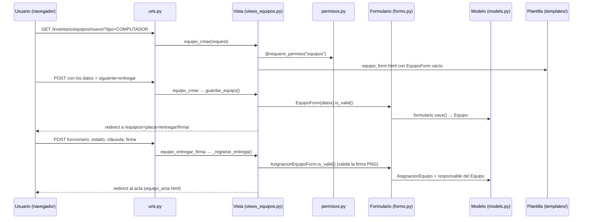

# Guía para entender el código de JANO Inventario

Esta guía es el punto de partida para entender la plataforma por dentro. No reemplaza a las otras guías:

| Documento | Qué explica |
|---|---|
| **GUIA_DEL_CODIGO.md** (esta) | Cómo leer el código, el recorrido de una pantalla, el mapa completo de rutas y recetas para cambios comunes |
| [ARQUITECTURA.md](ARQUITECTURA.md) | Qué hace la plataforma, tecnología, modelos de datos, roles y flujos de negocio |
| [OPERACION.md](OPERACION.md) | Arrancar, detener, respaldar, tareas programadas y actualizar |
| [INSTALAR_EN_SERVIDOR.md](INSTALAR_EN_SERVIDOR.md) | Instalación en el hosting |

Todo el código tiene documentación en español:

- **Python:** cada módulo, clase y función tiene su *docstring* (el texto entre `"""` al inicio) que dice qué hace, qué recibe y qué devuelve. Las únicas excepciones son las clases `Meta` de Django (configuración estándar) y los métodos de prueba, cuyo nombre ya describe lo que prueban.
- **Plantillas HTML:** cada una empieza con un bloque `` que dice qué pantalla es, qué vista la pinta y qué datos espera.
- **JavaScript y CSS:** cada archivo empieza con un comentario de propósito.

En VS Code, al pasar el mouse sobre el nombre de una función se ve su docstring.

---

## 1. Por dónde empezar a leer

Lee en este orden; cada paso se apoya en el anterior:

1. **`config/settings.py`**: cómo se configura (variables de entorno, base de datos, correo).
2. **`inventario/models.py`**: las tablas. Lee el docstring de cada clase: dice qué representa y sus reglas. El diagrama está en ARQUITECTURA.md §4.
3. **`inventario/permisos.py`**: los roles y qué acción puede hacer cada uno (`ACCIONES`). Corto y clave: casi todas las vistas lo usan.
4. **`inventario/urls.py`**: la lista de direcciones. Cada línea dice qué vista atiende cada URL (el mapa completo está en la sección 4).
5. **Una vista completa**, por ejemplo `equipo_entregar_firma` en `inventario/views_equipos.py`, siguiendo el recorrido de la sección 2.
6. **`templates/base.html`**: el marco de todas las pantallas internas (menú, barra superior, mensajes).
7. Después, el módulo que necesites: los archivos están agrupados por tema (ARQUITECTURA.md §3).

## 2. Recorrido de una pantalla, paso a paso

Ejemplo real: **registrar un computador y entregarlo con firma**.

Lo que pasa en cada pieza:

| Pieza | Archivo | Qué hace en este ejemplo |
|---|---|---|
| Ruta | `inventario/urls.py` | `equipos/nuevo/` → `views_equipos.equipo_crear`; `equipos/<placa>/entregar/firma/` → `equipo_entregar_firma` |
| Permiso | `inventario/permisos.py` | `@requiere_permiso("equipos")` deja pasar solo al encargado de inventario |
| Vista | `inventario/views_equipos.py` | `guardar_equipo` valida y guarda; si se pulsó «Guardar y entregar con firma» redirige a la firma |
| Formulario | `inventario/forms.py` | `EquipoForm` y `AsignacionEquipoForm` validan los datos; `validar_firma` revisa la imagen |
| Modelo | `inventario/models.py` | `Equipo` y `AsignacionEquipo` (una sola entrega vigente por equipo) |
| Plantilla | `templates/inventario/` | `equipo_form.html`, `equipo_entrega_firma.html` (incluye `_entrega_equipo_campos.html` y `_firma.html`) y `equipo_acta.html` |
| Auditoría | `inventario/auditoria.py` | Registra solo cada cambio (quién, cuándo, qué), sin código en la vista |
| Integración | `api_integracion/signals.py` | Al guardar el equipo publica un evento para Gestión TIC |

Todas las pantallas siguen este mismo patrón: **URL → vista → (permiso) → formulario → modelo → plantilla**.

## 3. Conceptos que aparecen en todo el código

| Término | Significado | Dónde |
|---|---|---|
| Equipo | Cualquier activo de TI. Los radios tienen además su tabla `Radio` (uno a uno) | `Equipo`, `Radio` |
| Placa | Identificador visible del equipo (único). Las URL de equipos usan la placa | `Equipo.placa` |
| Entrega / asignación | Un equipo en manos de alguien. Radios → a un puesto (`AsignacionRadio`); demás → a un funcionario (`AsignacionEquipo`) | `models.py` |
| Acta | La entrega impresa con cláusula y firma | `equipo_acta.html`, `asignacion_acta.html` |
| Firma | Imagen PNG en texto (*data URL*) dibujada en un lienzo | `_firma.html`, `forms.validar_firma` |
| Semáforo | Estado del preventivo: vigente, próximo, vencido, sin registro (6 meses) | `estado_mantenimiento.py` |
| Intervención | Un mantenimiento realizado | `MantenimientoEquipo` |
| Programación | Una visita prevista | `MantenimientoProgramado` |
| Cliente / puesto | Catálogo de clientes de Seguridad Jano y sus puestos de servicio | `Cliente`, `Puesto` |
| Retiro / paz y salvo | Proceso al salir un funcionario: validar sus equipos y emitir el documento | `personas.py`, `views_personas.py` |
| Solicitud / ticket | Caso de la mesa de ayuda | `Ticket`, `tickets.py` |
| Embed / marco | Pantallas que se cargan dentro de otra (la ficha en la lista de equipos). Llevan `?embed=1` | `equipo_pestanas.html` |
| Regularizar | Corregir datos importados: entregas sin acta, firmas, puestos, correos | `calidad.py` |
| Outbox / inbox | Colas de eventos con Gestión TIC: no se pierden datos si falla la red | `api_integracion/models.py` |

## 4. Mapa de rutas: URL → vista → plantilla

**Acceso:** «sesión» = cualquier usuario que haya ingresado; un nombre (`equipos`, `entregas`…) = acción de `permisos.py` exigida con `@requiere_permiso`. Algunas vistas revisan permisos adentro (por ejemplo, las de solicitudes según el rol); eso está en su docstring.

### Inicio, ingreso y cuentas (`usuarios/`)

| URL | Vista | Plantilla | Acceso | Qué hace |
|---|---|---|---|---|
| `/` | `usuarios/views.inicio` | `usuarios/inicio.html` | sesión | Dashboard según el rol |
| `/login/` | `login_view` | `usuarios/login.html` | público | Ingreso |
| `/logout/` | `LogoutView` de Django | — | sesión | Salir |
| `/usuarios/` | `usuarios_lista` | `usuarios/usuarios_lista.html` | superusuario | Cuentas de la plataforma |
| `/usuarios/crear/` | `usuario_crear` | `usuarios/usuario_form.html` | superusuario | Crear cuenta con rol |
| `/usuarios/<id>/editar/` | `usuario_editar` | `usuarios/usuario_form.html` | superusuario | Editar cuenta |
| `/cuenta/recuperar/` y siguientes | Vistas de contraseña de Django (`usuarios/urls_cuenta.py`) | `cuenta/*.html` | público | Crear o recuperar la contraseña por correo |

### Equipos (`inventario/views_equipos.py`)

| URL | Vista | Plantilla | Acceso | Qué hace |
|---|---|---|---|---|
| `/inventario/equipos/tipos/` | `equipos_inicio` | `equipos_inicio.html` | sesión | Tarjetas por tipo |
| `/inventario/equipos/` | `equipos_lista` | `equipos_lista.html` | sesión | Lista con filtros y ficha en marco |
| `/inventario/equipos/bajas/` | `equipos_bajas` | `equipos_bajas.html` | sesión | Baúl de bajas |
| `/inventario/buscar/` | `buscar_json` | — (JSON) | sesión | Buscador de la barra superior |
| `/inventario/equipos/nuevo/` | `equipo_crear` → `guardar_equipo` | `equipo_tipo.html`, `equipo_form.html` | equipos | Registrar equipo |
| `/inventario/equipos/<placa>/` | `equipo_detalle` | — (redirige) | sesión | Atajo a la ficha en la lista |
| `/inventario/equipos/<placa>/pestanas/` | `equipo_pestanas` → `render_equipo_pestanas` | `equipo_pestanas.html` / `radio_pestanas.html` | sesión | Ficha con pestañas (en marco) |
| `/inventario/equipos/<placa>/editar/` | `equipo_editar` | `equipo_form.html` o la ficha | equipos | Editar |
| `/inventario/equipos/<placa>/baja/` · `/reactivar/` | `equipo_dar_baja` · `equipo_reactivar` | — (POST) | equipos | Baja y reactivación |
| `/inventario/equipos/<placa>/entregar/` | `equipo_entregar` | pestaña «Entregar» de la ficha | entregas | Entrega desde la ficha |
| `/inventario/equipos/<placa>/entregar/firma/` | `equipo_entregar_firma` | `equipo_entrega_firma.html` | entregas | Entrega firmada en página completa (`?regularizar=1` desde Calidad de datos) |
| `/inventario/entregas-equipos/<id>/devolver/` | `equipo_devolver` | — (POST) | entregas | Devolución |
| `/inventario/entregas-equipos/<id>/acta/` | `equipo_acta` | `equipo_acta.html` | sesión | Acta imprimible |
| `/inventario/equipos/<placa>/hoja-de-vida/` | `equipo_hoja_vida` | `equipo_hoja_vida.html` | sesión | Hoja de vida imprimible |
| `/inventario/equipos/<placa>/cambio-gps/` | `equipo_cambio_gps` | `equipo_cambio_gps.html` | equipos | Cambio de línea o vehículo de un GPS |
| `/inventario/equipos/<placa>/antivirus/` | `equipo_renovar_antivirus` | `_antivirus_form_modal.html` | licencias | Renovar antivirus |
| `/inventario/politica/` | `politica_lista` | `politica_lista.html` | sesión | Estado de la política por computador |
| `/inventario/equipos/<placa>/politica/` | `politica_registrar` | `_politica_form_modal.html` | mantenimientos | Verificar la política |
| `/inventario/politica/<id>/` | `politica_detalle` | `_politica_detalle_modal.html` | sesión | Ver una verificación |
| `/inventario/mantenimientos/panel/` | `panel_mantenimientos` | `panel_mantenimientos.html` | sesión | Semáforo de mantenimiento |

### Radios y mantenimiento (`inventario/views.py`)

| URL | Vista | Plantilla | Acceso | Qué hace |
|---|---|---|---|---|
| `/inventario/radios/nuevo/` | `radio_crear` | `radio_form.html` | radios | Registrar radio |
| `/inventario/radios/<id>/editar/` | `radio_editar` | la ficha del radio | radios | Guardar edición |
| `/inventario/radios/<id>/transferir-componentes/` | `radio_transferir_componentes` | — (POST) | radios | Pasar piezas a otro radio (ver §7) |
| `/inventario/radios/<id>/baja/` · `/reactivar/` | `radio_dar_baja` · `radio_reactivar` | — (POST) | radios | Baja y reactivación |
| `/inventario/radios/<id>/` | `radio_detalle` | — (redirige) | sesión | Enlace antiguo |
| `/inventario/asignaciones/nueva/` | `asignacion_crear` | `asignacion_form.html` | entregas | Entregar radio a un puesto |
| `/inventario/asignaciones/<id>/acta/` | `asignacion_acta` | `asignacion_acta.html` | sesión | Acta del radio |
| `/inventario/asignaciones/<id>/devolver/` | `asignacion_devolver` | — (POST) | entregas | Devolución del radio |
| `/inventario/mantenimientos/` | `mantenimientos_lista` | `mantenimientos_lista.html` | sesión | Historial de intervenciones |
| `/inventario/mantenimientos/nuevo/` | `mantenimiento_crear` | `_mantenimiento_modal.html` | mantenimientos | Registrar intervención (ventana) |
| `/inventario/mantenimientos/programados/` | `mantenimientos_programados_lista` | `mantenimientos_programados_lista.html` | sesión | Visitas programadas |
| `/inventario/mantenimientos/programar/` | `mantenimiento_programado_crear` | `_mantenimiento_modal.html` | programar | Programar visita |
| `/inventario/mantenimientos/programados/<id>/completar/` · `/cancelar/` | `mantenimiento_programado_completar` · `_cancelar` | `_mantenimiento_modal.html` | mantenimientos · programar | Cerrar o cancelar visita |

### Personas, clientes, calidad, auditoría e informes

| URL | Vista | Plantilla | Acceso | Qué hace |
|---|---|---|---|---|
| `/inventario/personas/` | `views_personas.personas_lista` | `personas/lista.html` | sesión | Funcionarios |
| `/inventario/personas/nueva/` · `<id>/editar/` | `persona_crear` · `persona_editar` | `personas/form.html` | personas | Registrar o editar |
| `/inventario/personas/<id>/` | `persona_detalle` | `personas/detalle.html` | sesión | Ficha del funcionario |
| `/inventario/personas/<id>/retiro/` | `retiro_iniciar` | — (POST) | retiros | Iniciar retiro |
| `/inventario/paz-y-salvo/` | `retiros_lista` | `personas/retiros.html` | sesión | Retiros |
| `/inventario/paz-y-salvo/<id>/` | `retiro_detalle` | `personas/retiro.html` | sesión | Validar equipos del retiro |
| `/inventario/paz-y-salvo/item/<id>/validar/` | `retiro_item_validar` | — (POST) | validar_retiro | Validar un equipo |
| `/inventario/paz-y-salvo/<id>/emitir/` · `/cancelar/` | `retiro_emitir` · `retiro_cancelar` | — (POST) | retiros | Emitir o cancelar |
| `/inventario/paz-y-salvo/<id>/documento/` | `paz_y_salvo` | `personas/paz_y_salvo.html` | sesión | Documento imprimible |
| `/inventario/clientes/` | `views_catalogos.clientes_lista` | `clientes_lista.html` | sesión | Clientes |
| `/inventario/clientes/nuevo/` | `cliente_crear` | — (POST) | entregas | Nuevo cliente |
| `/inventario/clientes/<id>/` | `cliente_detalle` | `cliente_detalle.html` | sesión | Ficha y puestos |
| `/inventario/clientes/<id>/puestos/nuevo/` | `puesto_crear` | — (POST) | entregas | Nuevo puesto |
| `/inventario/clientes/<id>/estado/` · `/puestos/<id>/estado/` | `cliente_cambiar_estado` · `puesto_cambiar_estado` | — (POST) | entregas | Activar o desactivar |
| `/inventario/clientes/puestos.json` | `puestos_json` | — (JSON) | sesión | Puestos de un cliente (formulario de entrega) |
| `/inventario/calidad-datos/` | `views_calidad.calidad_datos` | `calidad_datos.html` | equipos | Pendientes de calidad de datos |
| `/inventario/calidad-datos/vincular-puesto/` | `vincular_puesto` | `calidad_vincular_puesto.html` | radios | Vincular radios a un puesto |
| `/inventario/calidad-datos/correos/` | `guardar_correos` | — (POST) | personas | Guardar correos |
| `/inventario/calidad-datos/estados/` | `completar_estados` | — (POST) | equipos | Completar estados operativos |
| `/inventario/entregas-equipos/<id>/firmar/` | `entrega_firmar` | `entrega_firmar.html` | entregas | Firmar una entrega existente |
| `/inventario/auditoria/` | `views_auditoria.auditoria_lista` | `auditoria.html` | auditoria | Bitácora |
| `/inventario/informes/` | `informes/views.inicio_informes` | `informes_inicio.html` | sesión | Lista de informes |
| `/inventario/informes/<clave>/` | `vista_previa` | `informe_detalle.html` | según el informe | Vista previa |
| `/inventario/informes/<clave>/excel/` · `/pdf/` | `exportar_informe_excel` · `_pdf` | — (archivo) | según el informe | Descargas |

### Mesa de ayuda (`views_tickets.py`, `views_portal.py`, `views_publicas.py`)

| URL | Vista | Plantilla | Acceso | Qué hace |
|---|---|---|---|---|
| `/inventario/solicitudes/` | `tickets_lista` | `tickets_lista.html` | sesión (TIC) | Bandeja |
| `/inventario/solicitudes/nueva/` | `ticket_crear` | `ticket_form.html` | tickets_crear | Registrar solicitud |
| `/inventario/solicitudes/agenda/` | `tickets_agenda` | `tickets_agenda.html` | sesión | Agenda de visitas |
| `/inventario/solicitudes/indicadores/` | `tickets_indicadores` | `tickets_indicadores.html` | sesión | Indicadores 90 días |
| `/inventario/solicitudes/<numero>/` | `ticket_detalle` | `ticket_detalle.html` | sesión | Detalle |
| `/inventario/solicitudes/<numero>/asignar/` · `/cancelar/` | `ticket_asignar` · `ticket_cancelar` | — (POST) | tickets_asignar | Asignar o cancelar |
| `/inventario/solicitudes/<numero>/iniciar/` · `/atender/` | `ticket_iniciar` · `ticket_atender` | `ticket_atencion.html` | técnico asignado | Atender y cerrar |
| `/inventario/solicitudes/<numero>/comentar/` | `ticket_comentar` | — (POST) | sesión | Comentario |
| `/inventario/solicitudes/fotos/<id>/` | `ticket_foto` | — (imagen) | sesión | Foto adjunta |
| `/mi-soporte/` (+ `nueva/`, `agendar/<id>/`) | `views_portal.*` | `portal/*.html` | solicitante | Portal del funcionario |
| `/soporte/` | `views_publicas.soporte_formulario` | `publico/soporte_formulario.html` | público | Pedir soporte con la cédula |
| `/soporte/caso/<token>/` | `soporte_caso` | `publico/soporte_caso.html` | enlace secreto | Seguimiento del caso |

### API para Gestión TIC (`api_integracion/`)

| URL | Vista | Acceso | Qué hace |
|---|---|---|---|
| `/api/v1/equipos/` · `/api/v1/radios/` | `EquiposAPI` · `RadiosAPI` | token, solo lectura | Datos para Gestión TIC |
| `/api/v1/indicadores/` | `IndicadoresAPI` | token | Indicadores del período |
| `/api/v1/eventos/gestion-tic/` | `recibir_evento_gestion_tic` | firma HMAC | Recibe eventos de Gestión TIC |

## 5. Recetas: dónde cambiar qué

| Quiero… | Dónde | Pasos |
|---|---|---|
| Agregar un campo a los equipos | `models.py` (`Equipo` o `Detalle…`), `forms.py` (`EquipoForm`/`Detalle…Form`), `views_equipos.pasos_formulario_equipo` | 1) agregar el campo al modelo; 2) `manage.py makemigrations`; 3) agregarlo a `fields` del formulario; 4) ubicarlo en un paso; 5) `manage.py migrate` (con respaldo) |
| Cambiar quién puede hacer algo | `permisos.py` → `ACCIONES` | Agregar o quitar el rol del conjunto de esa acción |
| Cambiar el texto de la cláusula de equipos | `forms.py` → `CLAUSULA_EQUIPOS` | Se ve en el formulario y en todas las actas |
| Cambiar los destinatarios de las alertas | `management/commands/procesar_alertas_mantenimiento.py` → `DESTINATARIOS` | Lista de correos |
| Agregar actividades de mantenimiento | `actividades_mantenimiento.py` | Por tipo de equipo |
| Cambiar los puntos de la política de seguridad | `politica.py` | Lista de puntos |
| Agregar un informe | `informes/<categoría>.py` | Crear la clase `Informe` y agregarla a `INFORMES` (ver docstring de `informes/base.py`) |
| Agregar una opción al menú | `templates/base.html` | Copiar un `jx-nav-link` dentro del grupo y proteger con `` |
| Cambiar colores o estilos | `static/css/jano.css` | Variables de color en `:root` al inicio y su versión oscura (`html[data-tema="dark"]`) justo después |
| Agregar un pendiente a Calidad de datos | `calidad.py` (consulta), `views_calidad.py` (`SECCIONES`), `calidad_datos.html` (pestaña) | Seguir el patrón de las secciones existentes |

**Siempre:** correr las pruebas (`manage.py test`) antes de publicar y respaldar la base antes de migrar (OPERACION.md).

## 6. Archivos sin uso (candidatos a eliminar)

Se revisaron uno por uno: ninguna vista, plantilla ni hoja los carga. Están marcados con «SIN USO» en su comentario. **No se han borrado**; conviene eliminarlos para que no confundan.

- **Plantillas:** `inventario/asignaciones_lista.html`, `radios_lista.html`, `equipo_detalle.html`, `equipo_entrega_form.html`, `radio_detalle.html`, `radio_detalle_respaldo.html`, `mantenimiento_form.html`, `politica_detalle.html`, `politica_form.html`.
- **CSS:** `static/css/15-lista-filtros.css`, `17-panel-inicio.css`, `20-jano-dashboard.css`, `paginas/mantenimientos-lista.css`, `paginas/mantenimientos-programados.css`, y los `*.backup_*`.
- **JS:** `static/js/lista-filtros.js`.
- **Python:** `inventario/views_antes_mantenimiento.py`, `revisar_modelos.py`, la carpeta `backups/`.

## 7. Problema conocido

**«Transferir componentes» de un radio no abre su ventana.** En la lista de equipos, el botón `[data-abrir-transferencia]` necesita el script `static/js/transferencia-componentes-radio.js`, pero ninguna plantilla lo carga (desde antes de que el proyecto estuviera en git). La ruta y la vista (`radio_transferir_componentes`) sí existen. Arreglo: cargar el script en `equipos_lista.html` y probarlo.
